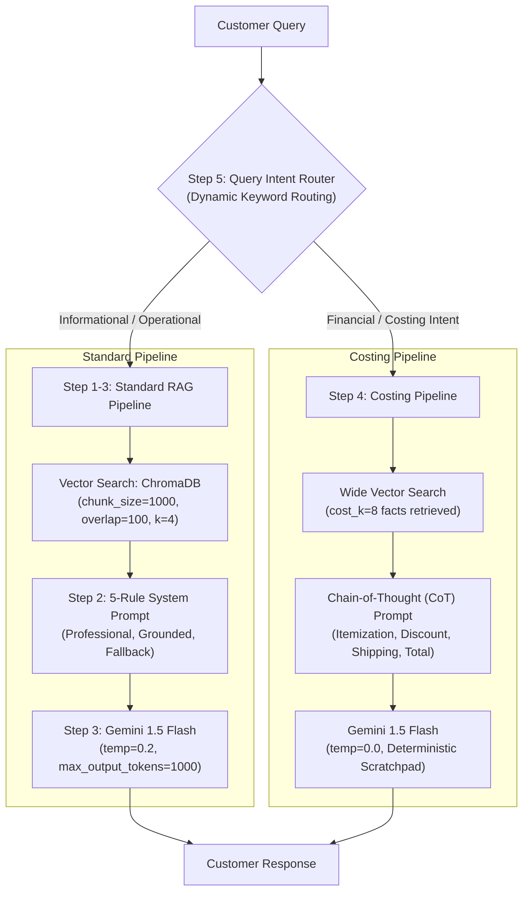

# DS314: Generative AI & LLM Systems — Midterm Practical Examination

**Institution:** University of Science and Technology of Southern Philippines (USTP) — BS Data Science 3A  
**Course Code:** DS314 (Generative AI & LLM Systems)  
**Authors:**
- **Rogelio Q. Mandamian III** ([@Troge-dev](https://github.com/Troge-dev))
- **Pandi**

---

## 📌 Project Overview: Rebuilding Rovi

This practical midterm project focuses on diagnosing, benchmarking, and re-architecting **Rovi**, an internal customer support chatbot for the **Rovelyn Sports Memorabilia Museum**. 

The baseline chatbot (created by an intern) failed across all core criteria due to four fundamental flaws:
1. **Unprofessional Tone:** Exaggerated streamer slang ("fam", "bro"), all-caps shouting, and emoji spam.
2. **Talks Too Short / Incomplete Information:** Critical policies were split or truncated mid-sentence.
3. **Bad at Costing:** Inability to perform arithmetic, missing multi-item prices, ignoring membership discounts, and failing shipping threshold rules.
4. **Misinforming / Hallucinating:** Confidently inventing tickets to live sporting events for a memorabilia exhibition.

Through systematic revision across five foundational GenAI topics (Settings, RAG Ingestion, Query Routing, Prompt Engineering, and Chain-of-Thought Reasoning), we transformed Rovi into a reliable, professional, and grounded customer service assistant.

---

## 📊 Scoreboard Comparison: Baseline vs. Rebuilt Rovi

| Evaluation Criterion | Baseline Broken Rovi | Rebuilt Rovi (`my_rovi`) | Improvement |
| :--- | :---: | :---: | :---: |
| **Professional Tone** | 0 / 6 (0%) | **6 / 6 (100%)** | **+100%** |
| **Complete Answers** | 0 / 3 (0%) | **3 / 3 (100%)** | **+100%** |
| **Correct Costing** | 0 / 2 (0%) | **2 / 2 (100%)** | **+100%** |
| **Honesty (Safeguards)** | 0 / 1 (0%) | **1 / 1 (100%)** | **+100%** |
| **Overall Pass Rate** | **0 / 12 (0%)** | **12 / 12 (100%)** | **+100%** |

---

## 🛠️ Architecture & Topic Mapping

Our engineering solution follows a 5-step pipeline mapped directly to DS314 topics:



1. **Step 1: Document Ingestion & Vector Retrieval (Topic 2)**
   - Increased `chunk_size` from `250` to `1000` to preserve full policy paragraphs intact (e.g., keeping the 48-hour return window attached to return instructions).
   - Added `chunk_overlap = 100` to prevent critical sentence boundary splits.
   - Expanded retriever from `k = 1` to `k = 4` to capture multi-topic queries.
2. **Step 2: System Message & Grounding Rules (Topic 4)**
   - Replaced intern streamer persona with 5 explicit behavioral rules:
     - **Rule 1:** Professional customer support identity without slang or emojis.
     - **Rule 2:** Complete answers in 2 to 5 sentences with conditions/deadlines.
     - **Rule 3:** Strict grounding to retrieved context only.
     - **Rule 4:** Exact honest fallback for out-of-scope queries (`"I am sorry, that information is not available in the Rovelyn Museum visitor guide."`).
     - **Rule 5:** Explicit data attribution to the 2022 visitor guide edition.
3. **Step 3: Model Hyperparameters (Topic 1)**
   - Lowered `temperature` from `1.5` to `0.2` for factual, deterministic replies.
   - Raised `max_output_tokens` from `48` to `1000` to eliminate mid-sentence generation cutoffs.
4. **Step 4: Chain-of-Thought Costing & Multi-Chunk Ingestion (Topic 5)**
   - Expanded retrieval to `cost_k = 8` to pull all pricing, discount, and shipping facts across distant document sections.
   - Enforced step-by-step arithmetic reasoning with intermediate scratchpad steps (unit prices -> subtotal -> 5% member discount -> delivery fee evaluation -> standardized `Total: PHP <amount>`).
5. **Step 5: Dynamic Query Routing (Topic 3)**
   - Implemented an intent classifier using a balanced keyword trigger list: `['total', 'how much will', 'how much do i', 'pay', 'cost', 'save', 'cheaper']`.

---

## 📂 Repository Contents

```text
├── .env.example                               # Environment template for Gemini API key
├── .gitignore                                  # Strict ignore rules (secures .env, caches, venv)
├── Mandamian_Pandi_DS314_Midterm_Exam.ipynb   # Complete, runnable practical examination notebook
├── rovelyn_museum_info_2022.pdf               # Source museum document (2022 edition)
├── requirements.txt                           # Project dependencies
└── README.md                                  # Documentation and architecture breakdown
```

---

## 🚀 Getting Started

### 1. Clone the Repository
```bash
git clone https://github.com/Troge-dev/DS314-GenAI-Midterm-Exam-Mandamian-Pandi.git
cd DS314-GenAI-Midterm-Exam-Mandamian-Pandi
```

### 2. Set Up Python Virtual Environment
```bash
# Windows
python -m venv .venv
.venv\Scripts\activate

# Linux / macOS
python3 -m venv .venv
source .venv/bin/activate
```

### 3. Install Dependencies
```bash
pip install -r requirements.txt
```

### 4. Configure Your API Key
Copy the example environment file and insert your Google Gemini API key:
```bash
# Windows PowerShell
Copy-Item .env.example .env

# Linux / macOS
cp .env.example .env
```
Open `.env` and paste your key:
```env
GEMINI_API_KEY_1=AIzaSy...
```

### 5. Launch the Notebook
```bash
jupyter notebook Mandamian_Pandi_DS314_Midterm_Exam.ipynb
```

---

## 📜 Academic Integrity & License
This repository is submitted as partial fulfillment of the requirements for **DS314 (Generative AI & LLM Systems)**. Academic review and grading use only.
